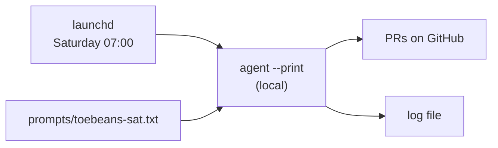

# Minimum viable local schedule (what you actually need)

This is the smallest working setup. Everything else in this directory is optional hardening.

## The plan, in four steps

1. Install the Cursor CLI and log in once.
2. Confirm the model string your account accepts.
3. Put one prompt file per run.
4. One launchd job per run that invokes `agent --print` with that prompt.

That is the whole design. No Terraform, no cloud, no server.



## Step 1: install and log in (once)

```
curl https://cursor.com/install -fsS | bash
~/.local/bin/agent login
```

Login opens a browser. I cannot do this for you.

Verify:

```
~/.local/bin/agent status
```

## Step 2: confirm the model string

```
~/.local/bin/agent models | grep -i grok
```

Whatever that prints is the string to use. The driver's default,
`grok-4.7-medium`, is confirmed for this account as of 2026-11-06.

## Step 3: prompts

Four files already exist in `prompts/`. Each is the full instruction for one run. Edit them as plain
text; no code involved.

## Step 4: the job

The simplest possible launchd job, no wrapper script:

```xml
<key>ProgramArguments</key>
<array>
  <string>/Users/dubs/.local/bin/agent</string>
  <string>--print</string>
  <string>--force</string>
  <string>--model</string>
  <string>grok-4.7-medium</string>
  <string>--workspace</string>
  <string>/Users/dubs/Projects/toebeans</string>
</array>
```

with the prompt passed on stdin from the `.txt` file, or inlined as the final argument.

Install it:

```
bash /Users/dubs/Projects/scripts/scheduler/install-weekend-sprints.sh
```

That script exists to save you writing four near-identical plists by hand. It is convenience, not
architecture.

---

## So do we still need the scripts?

| Script | Needed? | What it adds |
|---|---|---|
| `install-weekend-sprints.sh` | convenience | writes and loads four plists instead of one by hand |
| `sprint-run.sh` | optional | preflight, logging, lock, notifications |
| `prompts/*.txt` | **yes** | the actual instructions |

If you deleted both scripts, you could still do this in one launchd plist and a one-line command.
What the scripts buy you is not capability, it is the failure handling described next.

## What `sprint-run.sh` actually guards (the part worth keeping)

Each check exists because the corresponding failure is silent otherwise. All four were real bugs
found while building this:

| Guard | Failure it prevents |
|---|---|
| contract file exists | run starts, cannot find its instructions, wastes a request |
| `agent status` check | runs unauthenticated, exits instantly, no PR, easy to miss |
| model present in `agent models` | bad model string fails every Saturday |
| lock file | two runs overlap and fight over the same repo |
| log rotation | log directory grows without bound |
| notification on failure | a 7am failure goes unnoticed for a week |

The pattern: a naive cron job that dies silently is worse than no cron job, because you believe it
ran.

## Failure modes to expect on the first real run

- **Auth expired.** Cursor sessions can expire. The guard catches it and notifies you, but the run
  does not happen.
- **Machine asleep.** launchd defers a missed job until wake. If the laptop is shut all weekend, the
  sprint runs Monday.
- **Model string wrong.** `agent models` verification catches it before the run, not during.
- **The run does work you did not want.** `--force` means no approval prompts. Read the contracts in
  each repo before the first Saturday.

## Recommended order

1. `agent login` and confirm `agent models`.
2. Dry run: `SPRINT_DRY_RUN=1 bash sprint-run.sh toebeans sat`.
3. One forced real run to see the actual output:
   `launchctl kickstart -k gui/$(id -u)/com.dubs.weekend-sprint.toebeans-sat`
4. Read the log. If it looks right, let Saturday happen.
