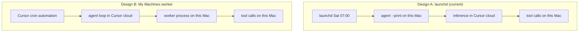

# My Machines: the third option, and when it wins

A correction to something stated earlier in this session, plus the decision table for choosing
between the two local-execution designs.

## The correction

Earlier I said Cursor Automations only run in cloud VMs and therefore cannot build an Android app.
**That was wrong.** The accurate model, quoted from Cursor's docs and confirmed in the local CLI:

> Cursor runs the agent loop, inference, and planning. Your worker performs file edits and terminal
> commands.
> (source) https://cursor.com/docs/cloud-agent/self-hosted

So with a self-hosted worker, every `./gradlew`, `adb`, and emulator command executes on this Mac.
Inference happens in Cursor's cloud; the work happens locally. A cron automation can therefore drive a
local Android build.

Confirmed on this machine from `agent worker --help`:

> My Machines: a personal worker for the signed-in user. Works on any plan with Cloud Agents; no
> Enterprise plan or service account is needed.

## The two designs

Both end with tool calls running locally. The difference is **who owns the schedule** and **how many
long-lived processes must be alive**.

## Decision table

| | Design A: launchd + CLI | Design B: cron automation + My Machines |
|---|---|---|
| Schedule lives in | launchd, on this Mac | Cursor, in the cloud |
| Visible in Cursor app | no | yes |
| Long-lived process required | none | `agent worker start` must be running |
| Machine asleep at 07:00 | launchd defers, runs on wake | automation fails in ~15s, no queue |
| Setup steps | install CLI, log in, install plist | install CLI, log in, start worker, route automation to it |
| Plan floor | any paid plan | Premium or higher (Cloud Agents required) |
| Dashboard secrets on the Mac | n/a | not delivered; uses machine credentials |
| Repo checkout | your existing tree | your existing tree; worker never clones on My Machines |
| Failure visibility | log file + macOS notification | Cursor run history |
| Extra moving part | none | the worker daemon |

## When B is the better trade

- You want runs visible in the Cursor app, with history you can read later.
- You want the schedule to survive reinstalling the OS or moving machines.
- You are willing to keep a worker process alive and the lid open.

Apple Silicon is an explicitly documented reason to use My Machines: Cursor-hosted VMs are x86_64,
so arm64 builds need a local worker.

## When A is the better trade

- You want the fewest moving parts and no daemon.
- You care that a missed run is deferred rather than failed. launchd coalesces a missed job; My
  Machines has no queue and reports machine-offline after about 15 seconds.
- You do not need run history in the app, because the PRs and logs are enough.

That is the current choice: A is installed, B is documented here and not built.

## If you want B

1. `agent login`, then confirm your plan includes Cloud Agents (`agent status`).
2. Start the worker against the checkout, disabling idle release:
   `agent worker start --worker-dir /Users/dubs/Projects/toebeans --idle-release-timeout 0`
   (the default idle release is 3600s; the docs describe the worker as long-lived, the CLI has the
   timeout, so set it explicitly rather than assume).
3. Keep it alive under launchd with `KeepAlive` so a crash restarts it. An offline worker means a
   failed run, not a queued one.
4. Route each automation to the machine: in the automation editor, environment picker, Remote
   Machines, My Machines. Or, via the Terraform resource, `private_worker` with `labels` matched
   exactly.
5. Note: `worker=` and `machine=` strings do not apply to cron triggers. Those are Slack, GitHub and
   Linear only.

## The thing to test before trusting B

Wake the machine at 07:00 with the lid closed and confirm a run actually happens. That single test
decides whether B is viable for an unattended weekend job, and it is the assumption I would not
accept without evidence.
